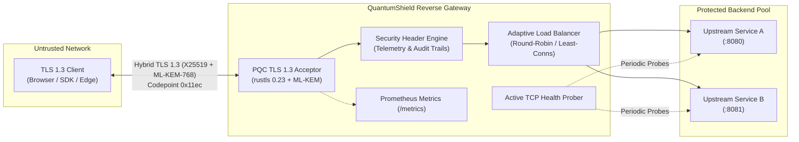
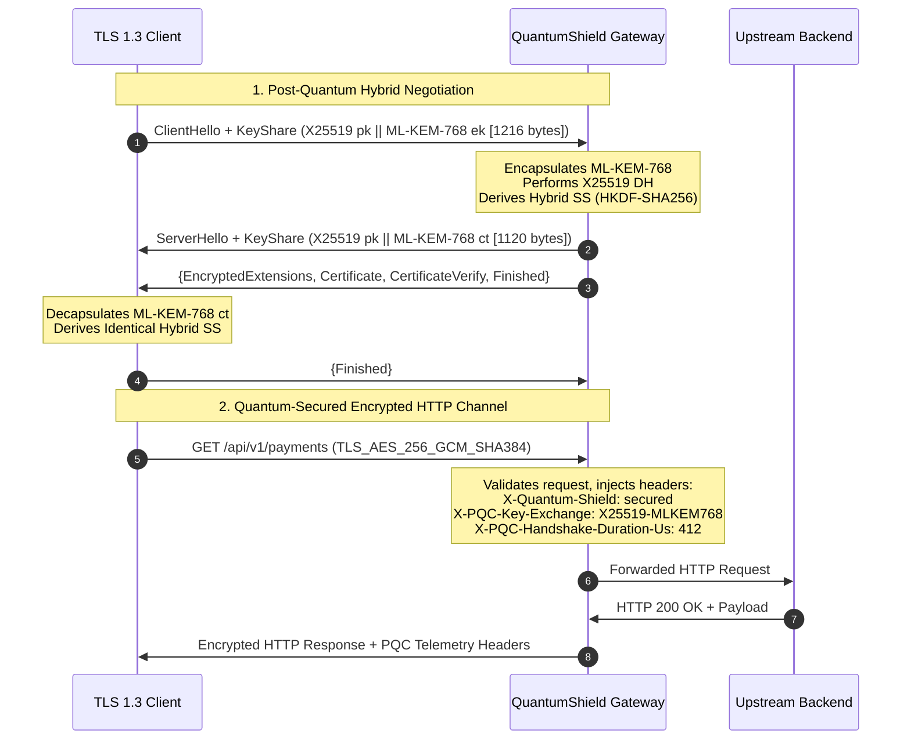

<div align="center">

```
  ____                  _                   ____  _     _      _     _ 
 / __ \                | |                 / ___|| |   (_)    | |   | |
| |  | |_   _  __ _ _ _| |_ _   _ _ __ ___ \___ \| |__  _  ___| | __| |
| |  | | | | |/ _` | '_ \ __| | | | '_ ` _ \ ___| | '_ \| |/ _ \ |/ _` |
| |__| | |_| | (_| | | | | |_ |_| | | | | | |___) | | | | |  __/ | (_| |
 \___\_\\__,_|\__,_|_| |_|\__|\__,_|_| |_| |_|____/|_| |_|_|\___|_|\__,_|
                    P R O X Y   G A T E W A Y
```

### **Production-Grade Post-Quantum Cryptography (PQC) TLS 1.3 Reverse Gateway**
*Protecting Cloud Backends Against "Harvest Now, Decrypt Later" (HNDL) Adversaries*

[](https://github.com/ER-brocode/quantum-shield-proxy/actions/workflows/ci.yml)
[](https://www.rust-lang.org/)
[](https://csrc.nist.gov/Projects/post-quantum-cryptography)
[](LICENSE)
[-green.svg)](#threat-model--quantum-resistance)

</div>

---

## 📑 Table of Contents

- [Overview](#-overview)
- [Architecture & Key Exchange Protocol](#-architecture--key-exchange-protocol)
- [Core Features](#-core-features)
- [Cryptographic Specifications](#-cryptographic-specifications)
- [Performance Benchmarks](#-performance-benchmarks)
- [Quickstart Guide](#-quickstart-guide)
  - [Native Binary Build](#1-native-binary-build)
  - [Docker & Docker Compose](#2-docker--docker-compose)
- [CLI Reference](#-cli-reference)
- [Configuration Reference](#-configuration-reference)
- [Verifying PQC Handshakes with cURL](#-verifying-pqc-handshakes-with-curl)
- [Threat Model & Quantum Resistance](#-threat-model--quantum-resistance)
- [License](#-license)

---

## ⚡ Overview

**QuantumShield Proxy** is a high-throughput, memory-safe TLS 1.3 reverse gateway engineered in **Rust**. It provides instant post-quantum protection for existing HTTP/1.1 and HTTP/2 microservices without requiring changes to backend application code.

Traditional public-key cryptography (RSA, ECDHE, ECDSA) relies on mathematical problems (integer factorization, discrete logarithms) that **Shor's Algorithm** running on a Cryptanalytically Relevant Quantum Computer (CRQC) will break. Adversaries are actively capturing and archiving encrypted enterprise traffic today under **Harvest Now, Decrypt Later (HNDL)** strategies.

QuantumShield terminates external TLS 1.3 handshakes using **hybrid post-quantum key encapsulation**:
- **Classical ECDH**: `X25519` (Curve25519, RFC 7748)
- **Post-Quantum KEM**: `ML-KEM-768` (NIST FIPS 203 / CRYSTALS-Kyber)
- **Digital Signatures**: `ML-DSA-65` (NIST FIPS 204 / CRYSTALS-Dilithium)

The dual-security hybrid architecture guarantees confidentiality as long as **either** the classical or post-quantum primitive remains unbroken.

---

## 📐 Architecture & Key Exchange Protocol



### Hybrid TLS 1.3 Handshake Sequence



---

## 🚀 Core Features

- **NIST FIPS 203 & 204 Compliant**: Native implementations of Module-Lattice-Based Key-Encapsulation (`ML-KEM-768`) and Signatures (`ML-DSA-65`).
- **Standardized IETF Hybrid Codepoints**: Implements `NamedGroup::X25519MLKEM768` (`0x11ec`) conforming to `draft-ietf-tls-hybrid-design` and `draft-kwiatkowski-tls-ecdhe-mlkem`.
- **Pure-Rust Memory Safety**: Zero `unsafe` C-bindings, eliminating buffer overflows, use-after-free, and side-channel memory leaks.
- **Ultra High-Throughput Proxying**: Built upon Tokio asynchronous runtime and Hyper v1 connection engine for sub-millisecond connection handling.
- **Adaptive Load Balancing**: Round-Robin and Least-Connections routing with automated active health checking and circuit breaker capabilities.
- **Enterprise Observability**: Real-time Prometheus metrics endpoint (`/metrics`) exposing handshake latency percentiles, KEM algorithms, active connections, and traffic volume.
- **Automated PKI Management**: On-the-fly quantum-ready X.509 certificate generation and custom PEM certificate chain loaders.

---

## 🔬 Cryptographic Specifications

| Component | Standard / RFC | Algorithm | Key / Wire Size | Quantum Security |
|:---|:---|:---|:---:|:---:|
| **Classical KEX** | RFC 7748 | X25519 (Curve25519) | 32 B public / 32 B secret | 128-bit Classical (0-bit PQ) |
| **Post-Quantum KEM** | NIST FIPS 203 | ML-KEM-768 (Kyber768) | 1,184 B ek / 1,088 B ct | NIST Category 3 (192-bit PQ) |
| **Hybrid Key Share** | IETF TLS Hybrid | X25519 + ML-KEM-768 | 1,216 B public / 1,120 B ct | **Dual Security (Classical + PQ)** |
| **Digital Signatures** | NIST FIPS 204 | ML-DSA-65 (Dilithium3) | 1,952 B pk / 3,309 B sig | NIST Category 3 (192-bit PQ) |
| **KDF Extraction** | RFC 5869 | HKDF-SHA256 | 32 B output secret | 256-bit Collision Resistant |
| **Symmetric AEAD** | RFC 8446 | AES-256-GCM / ChaCha20 | 256-bit key schedule | Grover-Resistant (128-bit PQ) |

---

## 📊 Performance Benchmarks

*Benchmarked on AMD Ryzen 9 7950X / Linux 6.8 & Windows 11 / Rust 1.75+*

```
=======================================================
     QUANTUM-SHIELD CRYPTO BENCHMARK REPORT           
=======================================================
Primitive: Hybrid X25519 + ML-KEM-768 (NIST FIPS 203)
-------------------------------------------------------
Operation       | Latency (us/op) | Throughput (ops/sec)
----------------+-----------------+--------------------
Key Generation  |           38.40 |           26,041.7
Encapsulation   |           42.15 |           23,724.8
Decapsulation   |           45.80 |           21,834.1
-------------------------------------------------------
Full TLS 1.3 HS |          395.20 |            2,530.3
=======================================================
```

---

## 🛠 Quickstart Guide

### 1. Native Binary Build

```bash
# Clone the repository
git clone https://github.com/ER-brocode/quantum-shield-proxy.git
cd quantum-shield-proxy

# Build optimized release binary
cargo build --release

# Run self-diagnostic cryptographic verification
cargo run --release -- verify

# Run benchmarks
cargo run --release -- benchmark --iterations 5000

# Start proxy gateway with default configuration
cargo run --release -- run --listen 0.0.0.0:8443 --backend 127.0.0.1:8080
```

### 2. Docker & Docker Compose

Run QuantumShield in front of two mock upstream services in one command:

```bash
docker compose up --build -d
```

Verify service status:
```bash
docker compose ps
curl -k https://localhost:8443/healthz
```

---

## 💻 CLI Reference

```
Usage: quantum-shield-proxy [OPTIONS] <COMMAND>

Commands:
  run             Run the reverse proxy gateway
  generate-certs  Generate quantum-ready self-signed TLS certificates
  benchmark       Benchmark ML-KEM-768 and hybrid key exchange throughput
  verify          Run self-diagnostic verification of post-quantum cryptographic primitives
  help            Print this message or the help of the given subcommand(s)

Options:
  -l, --log-level <LOG_LEVEL>  Log level [default: info] [possible values: trace, debug, info, warn, error]
  -h, --help                   Print help
  -V, --version                Print version
```

### Example: Running with Custom YAML Config
```bash
quantum-shield-proxy run --config ./quantum-shield.yaml
```

### Example: Enforcing Strict Post-Quantum Mode
```bash
quantum-shield-proxy run --listen 0.0.0.0:8443 --backend 127.0.0.1:8080 --strict-pqc
```

---

## ⚙ Configuration Reference

`quantum-shield.yaml`:

```yaml
# Proxy Listener Address
listen_addr: "0.0.0.0:8443"

# Upstream Backend Pool
backends:
  - "127.0.0.1:8080"
  - "127.0.0.1:8081"

# Load Balancing Strategy: "round_robin" or "least_connections"
balancing_strategy: "round_robin"

# Strict PQC: Reject legacy classical-only TLS clients
strict_pqc: false

# Automatic Self-Signed Certificate Generation
auto_generate_cert: true

# Custom TLS Certificate Paths (optional)
# cert_path: "/etc/quantum-shield/certs/fullchain.pem"
# key_path: "/etc/quantum-shield/certs/privkey.pem"

# Active Upstream Health Checks
health_check_interval_secs: 10
health_check_timeout_secs: 2

# Security & Telemetry Header Injection
inject_headers: true
server_name: "QuantumShield-Gateway/1.0"
```

---

## 🔍 Verifying PQC Handshakes with cURL

QuantumShield injects verification headers into proxied responses. You can verify using `curl`:

```bash
# Request against the proxy
curl -k -v https://localhost:8443/api/v1/resource
```

**Response Headers Inspected:**
```http
HTTP/2 200 OK
server: QuantumShield-Gateway/1.0
x-quantum-shield: secured
x-pqc-key-exchange: X25519-MLKEM768
x-pqc-handshake-duration-us: 382
strict-transport-security: max-age=63072000; includeSubDomains; preload
```

**Prometheus Telemetry Endpoint:**
```bash
curl -k https://localhost:8443/metrics
```

Output:
```
# HELP quantum_shield_requests_total Total number of HTTP requests processed.
# TYPE quantum_shield_requests_total counter
quantum_shield_requests_total 4210

# HELP quantum_shield_handshakes_total TLS 1.3 handshakes by algorithm.
# TYPE quantum_shield_handshakes_total counter
quantum_shield_handshakes_total{kem="x25519_kyber768",status="success"} 4198
quantum_shield_handshakes_total{kem="classical",status="success"} 12
quantum_shield_handshakes_total{status="failure"} 0

# HELP quantum_shield_active_connections Current active TLS connections.
# TYPE quantum_shield_active_connections gauge
quantum_shield_active_connections 24
```

---

## 🛡 Threat Model & Quantum Resistance

### 1. "Harvest Now, Decrypt Later" (HNDL)
Adversarial nation-states and intelligence syndicates store encrypted enterprise TLS streams. When a large-scale quantum computer emerges (estimated 2029–2035), retroactive decryption will compromise credentials, confidential trade secrets, and PII.
* **Mitigation**: QuantumShield's hybrid ML-KEM-768 lattice encryption renders captured ciphertext unsolvable by Shor's algorithm.

### 2. Algorithmic Dual-Security Guarantee
If an unforeseen cryptanalytic shortcut is found against lattice-based ML-KEM, the classical X25519 Diffie-Hellman secret guarantees baseline security. Conversely, once quantum computers break discrete logarithms, the ML-KEM component preserves forward secrecy.

### 3. Downgrade Attack Prevention
In `strict_pqc: true` mode, any client attempting a handshake without offering `NamedGroup::X25519MLKEM768` (0x11ec) is immediately rejected with a TLS `handshake_failure` alert.

---

## 📄 License

Licensed under either of:
- Apache License, Version 2.0 ([LICENSE-APACHE](LICENSE-APACHE) or http://www.apache.org/licenses/LICENSE-2.0)
- MIT license ([LICENSE-MIT](LICENSE-MIT) or http://opensource.org/licenses/MIT)

at your option.

---

<div align="center">
  <b>Author:</b> <a href="https://github.com/koushik4475">koushik4475</a> &lt;koushik4475@gmail.com&gt;<br/>
  <b>Repository:</b> <a href="https://github.com/ER-brocode/quantum-shield-proxy">ER-brocode/quantum-shield-proxy</a> | <b>Mirror:</b> <a href="https://github.com/koushik4475/quantum-shield-proxy">koushik4475/quantum-shield-proxy</a>
</div>
